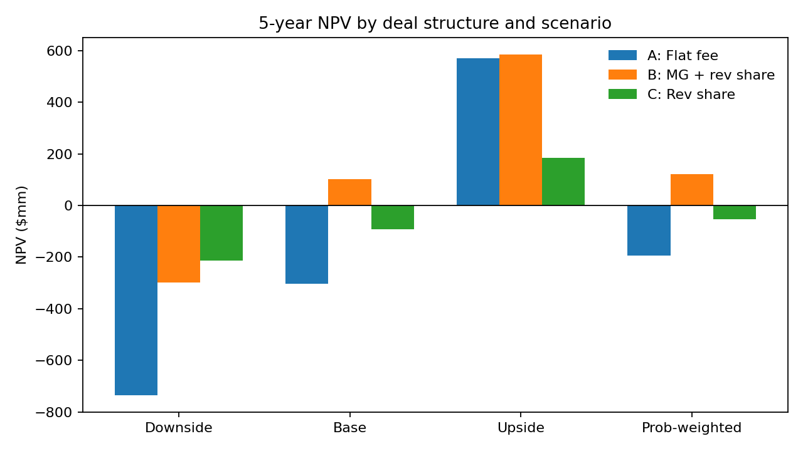
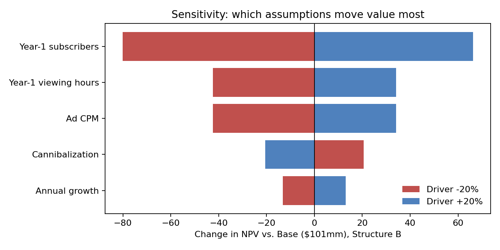
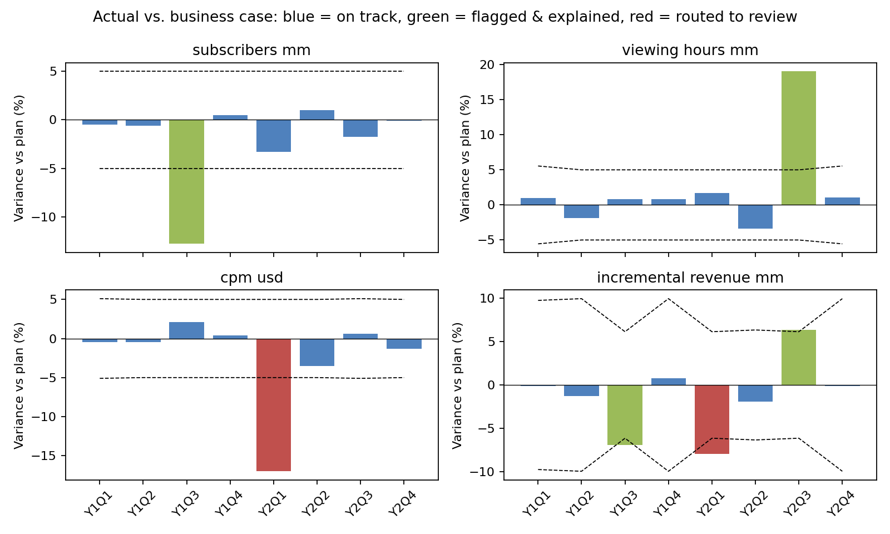

# Commercial Partnership Business Case: Live Sports Streaming Deal

A finance business case for a hypothetical deal: should a video platform sign a 5-year exclusive license for a mid-tier sports league's out-of-market live-games package, and which deal structure maximizes long-term value?

It compares three structures across three scenarios, identifies the assumptions that drive value, and sets up post-signing tracking against the business case. All inputs are benchmarked to public data from NFL Sunday Ticket on YouTube, MLS on Apple, the Alphabet 10-K, and CTV ad-pricing benchmarks.

## Result

**Recommendation: sign only under Structure B (minimum guarantee + revenue share), with a lower or step-up MG and a Year-2 exit right.** See the [one-page Finance Point of View](Finance_POV_Memo.md).

| 5-yr NPV ($mm) | Downside | Base | Upside | Prob-weighted |
|---|---|---|---|---|
| A: Flat license fee | (734) | (303) | 569 | (193) |
| **B: MG + revenue share** | (298) | **101** | 585 | **122** |
| C: Pure revenue share | (213) | (92) | 185 | (53) |

For Structure B in the Base case: **payback in Year 3**, and a breakeven of about **0.72M Year-1 subscribers vs. 1.0M assumed** (roughly a 28% cushion). Both are in the Excel model (`Memo` tab; breakeven on `Sensitivity`) and the [Finance POV memo](Finance_POV_Memo.md). Breakeven is a linear approximation, so treat it as approximate for Structure B, where the minimum guarantee creates a kink. All figures come from a hypothetical deal, not disclosed terms.




## What's inside

| Path | What it is |
|---|---|
| `Partnership_Business_Case_Model.xlsx` | Formula-driven Excel model: sourced Inputs, 5-year deal P&L per scenario, NPV/IRR/payback, probability weighting, tornado, variance tracking, memo |
| `deal_model.py` | Independent Python rebuild of the model. It reads the same Inputs, **validates every NPV against Excel** (matches to $0.000001mm), and draws the charts |
| `variance_tracking.py` | Post-signing plan-vs-actual tracking: per-KPI MAD-based thresholds and commentary gated on a documented event log |
| `event_log.csv` | Analyst-maintained drivers (simulated for this hypothetical) |
| `Finance_POV_Memo.md` | One-page recommendation |
| `sources.md` | Every benchmark and where it came from |

## Method

**Revenue.** Subscription revenue is subscribers × season price, net of app-store fees. Ad revenue is viewing hours × ad minutes × spots × CPM × fill rate.

**Two revenue lines, on purpose.** The partner's share is paid on *deal-attributable* revenue. The platform's value counts only *incremental* revenue, after subtracting cannibalized viewing that would have happened anyway. Treating these as the same number would overstate the deal.

**Structures.**
- A: flat fee with an escalator
- B: the greater of a minimum guarantee or X% revenue share
- C: pure revenue share

**Valuation.** 5-year pre-tax contribution, an upfront signing payment in Year 0, and a 10% discount rate (between Alphabet's 10-year median and current WACC estimates).

**Risk.**
- Downside/Base/Upside scenarios weighted 25/50/25
- A one-at-a-time ±20% tornado
- An approximate breakeven subscriber count

**Tracking.** Actuals vs. the Base case for subscribers, viewing hours, CPM, and incremental revenue. Variances are flagged with leave-one-out median + 3×scaled-MAD thresholds (5% floor). Flags are explained only when the event log documents a driver; otherwise they are routed to analyst review. This logic is carried over from my [Finance Forecast & Variance Automation](https://github.com/maitreyeetiwari5/Finance-Forecast-Variance-Automation) project.



## Run it

```bash
pip install -r requirements.txt
python deal_model.py              # scenario table, tornado, Excel validation, charts
python variance_tracking.py       # plan vs. actual flags -> variance_report.csv
```

To test your own view, change any blue input on the Excel **Inputs** tab and save; the scripts read from it.

## Limitations

- Hypothetical deal. Subscriber, fee, and cost inputs are benchmarked estimates, not disclosed terms.
- Pre-tax, 5-year horizon, no terminal value. Strategic value (engagement, cross-sell) is excluded, which makes the recommendation conservative.
- Quarterly plan splits annual figures evenly (no in-season seasonality). Actuals are simulated with a fixed seed.
- With only 8 quarters of history, MAD thresholds often sit at the 5% floor and widen when other anomalies fall in the window. A longer history would tighten them.
- AI-assisted build. Every output was validated independently: the Python model reproduces the Excel NPVs exactly.
